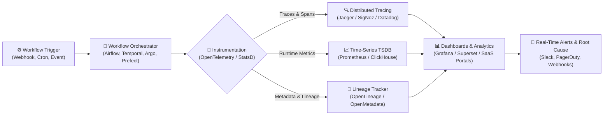

  

<h1 align="center">⚡ Awesome Workflow Execution Analytics &amp; Metrics 📊</h1>

  <strong>Curated ecosystem of SaaS platforms, open-source tools, distributed tracing engines, and telemetry dashboards for monitoring, latency profiling, and observability of automated workflows and DAG pipelines.</strong>

  
  
  
  
  
  

---

## 📌 Overview &amp; Architecture

Modern data, cloud, and engineering operations rely on automated workflows spanning distributed microservices, CI/CD pipelines, ETL orchestrators, and AI agent frameworks. **Workflow Execution Analytics and Observability** captures runtime metrics, task bottlenecks, step failure rates, queue backlog depths, and distributed spans to maintain high-throughput, fault-tolerant business execution.

---

## 📋 Table of Contents

- [📌 Overview & Architecture](#-overview--architecture)
- [🟦 SaaS / Hosted Platforms](#-saas--hosted-platforms)
  - [Postman Flows Analytics](#postman-flows-analytics)
  - [Datadog APM](#datadog-apm)
  - [New Relic Workflow Automation](#new-relic-workflow-automation)
  - [Dynatrace Workflows](#dynatrace-workflows)
  - [Grafana Cloud Workflows](#grafana-cloud-workflows)
  - [Mixpanel Flows](#mixpanel-flows)
  - [Segment](#segment)
  - [Honeycomb](#honeycomb)
  - [Coralogix](#coralogix)
- [🟩 Open-Source Software](#-open-source-software)
  - [Prometheus](#prometheus)
  - [Apache Airflow](#apache-airflow)
  - [SigNoz](#signoz)
  - [Temporal](#temporal)
  - [Prefect](#prefect)
  - [Jaeger](#jaeger)
  - [Argo Workflows](#argo-workflows)
  - [Dagster](#dagster)
  - [Flyte](#flyte)
  - [OpenTelemetry](#opentelemetry)
  - [OpenLineage](#openlineage)
  - [Domino](#domino)
  - [n8nTrace](#n8ntrace)
  - [Grafana n8n Dashboards](#grafana-n8n-dashboards)
- [📊 Comparison at a Glance](#-comparison-at-a-glance)
- [🤝 Contributing](#-contributing)
- [💖 Support & Sponsorship](#-support--sponsorship)
- [📈 Star History](#-star-history)
- [📄 License](#-license)

---

## 🟦 SaaS / Hosted Platforms

Commercial, cloud-hosted Workflow Execution Analytics and APM observability platforms. These provide managed telemetry pipelines, enterprise SLAs, and turn-key performance dashboards.

### 🌐 Postman Flows Analytics
- **Type:** API workflow execution analytics  
- **Description:** Postman Flows provides an Analytics dashboard for monitoring deployed flows running in Postman Cloud. Track run frequencies, step durations, and success/failure rates per block with granular run logs for input/output payloads [citation:1][citation:12]. Runs can be filtered by session ID, flow name, execution state, and trigger type.  
- **Best for:** Teams building API-centric microservices and integration workflows needing native cloud execution visibility.

### 🐶 Datadog APM
- **Type:** Application performance monitoring with trace pipelines  
- **Description:** Collects distributed traces across multi-service workflows. The Trace Pipeline enables custom sampling, retention filters, and post-ingestion span attribute transformation [citation:13]. Teams can derive custom execution metrics from spans for SLA alerting, combined with Synthetics and Real User Monitoring [citation:2].  
- **Best for:** Enterprise engineering teams requiring end-to-end distributed APM with custom metric generation from workflow spans.

### 🔮 New Relic Workflow Automation
- **Type:** Workflow execution monitoring with event telemetry  
- **Description:** Tracks total steps executed, step failure distributions, and run health via NRDB `WorkflowAutomationEvent` telemetry. Captures execution statuses (`STARTED`, `COMPLETED`, `FAILED`, `TIMED_OUT`), execution run IDs, latencies, and debug inputs/outputs across scheduled cron runs [citation:3][citation:14].  
- **Best for:** Organizations already standardizing on the New Relic Telemetry Data Platform wanting unified workflow execution logs and metrics.

### 🦅 Dynatrace Workflows
- **Type:** Workflow execution tracking with programmatic state inspection  
- **Description:** Monitors execution state (`SUCCESS`, `RUNNING`, `ERROR`, `WAITING`), trigger modes, and execution duration using the `IExecution` interface. The Automation Utils SDK provides programmatic access via `actionExecution()` and `getExecutionLink()`, allowing automated incident remediation and observability [citation:4][citation:15].  
- **Best for:** Enterprises needing automated root-cause analysis and programmatic state access within the Dynatrace ecosystem.

### 📈 Grafana Cloud Workflows
- **Type:** Workflow run observability (cloud-managed)  
- **Description:** Features a Latest Runs panel displaying recent workflow executions with status, execution durations, and step-level input/output drill-downs [citation:5]. Real-time step status streaming helps developers debug live running flows directly from the workflow builder interface.  
- **Best for:** Teams operating Grafana Cloud who want unified metric dashboards and integrated workflow run tracing.

### 📊 Mixpanel Flows
- **Type:** User journey & conversion flow analytics  
- **Description:** Analyzes step-by-step conversion funnels and user paths between product events. Supports bidirectional flow analysis (forward and reverse), multi-step filters, custom conversion windows, and Sankey visualization models [citation:6].  
- **Best for:** Product and growth teams tracking customer conversion journeys and funnel drop-off analytics.

### 🔄 Segment
- **Type:** Customer data pipeline & event streaming  
- **Description:** Standardizes event collection and routing across applications via client libraries (Identify, Track, Group). While designed for customer data, Segment pipes workflow event signals downstream into warehouses, APM tools, and real-time analytics platforms [citation:7].  
- **Best for:** Routing workflow lifecycle events and business actions to multiple downstream analytics destinations.

### 🐝 Honeycomb
- **Type:** High-cardinality observability with AI-assisted debugging  
- **Description:** High-cardinality distributed tracing engine featuring BubbleUp Insights to identify anomalous execution dimensions and root causes automatically [citation:8]. Integrates with GitHub to correlate execution latency regressions directly with code commits and deploys.  
- **Best for:** Engineering teams needing high-cardinality event investigation and automated bottleneck discovery across distributed workflow services.

### 🛡️ Coralogix
- **Type:** Observability with CI/CD workflow telemetry  
- **Description:** Provides GitHub Actions integration exporting completed pipeline telemetry. Visualizes CI/CD workflow executions as distributed traces with individual jobs mapped to spans [citation:9]. Exports failure rates, step durations, and pipeline throughput metrics (`github_workflow_failed_job_count_total`).  
- **Best for:** DevOps teams seeking granular execution traces, bottleneck identification, and alerting for CI/CD pipelines.

---

## 🟩 Open-Source Software

Self-hosted, community-driven Workflow Execution Analytics, monitoring, and orchestration platforms. Sorted descending by GitHub Star count.

### [Prometheus](https://github.com/prometheus/prometheus) 
- **Stack:** Go | **License:** Apache 2.0  
- **Description:** The industry standard for time-series metrics collection and alerting. Prometheus monitors workflow engines via custom metrics (`rate(workflow_process_error_count[5m])`, consumer lag, task latencies). Engines like Argo Workflows expose native Prometheus metrics on port 9090 out of the box [citation:10][citation:20].  
- **Best for:** Foundation time-series metrics, Prometheus Alertmanager notifications, and Grafana dashboard visualization.

### [Apache Airflow](https://github.com/apache/airflow) 
- **Stack:** Python | **License:** Apache 2.0  
- **Description:** The global benchmark for programmatic workflow orchestration. Airflow provides rich built-in execution analytics: task duration charts, landing times, Gantt views, execution status breakdowns, and native OpenTelemetry/StatsD metrics export for large-scale data engineering workflows.  
- **Best for:** Complex, programmatic DAG scheduling with built-in execution history, task latency graphs, and SLA monitoring.

### [SigNoz](https://github.com/signoz/signoz) 
- **Stack:** Go / TypeScript / ClickHouse | **License:** Open Source  
- **Description:** An open-source, OpenTelemetry-native APM and observability platform acting as an open alternative to Datadog. SigNoz combines traces, metrics, and logs powered by ClickHouse for rapid queries, making it ideal for deep execution tracing, step duration breakdown, and bottleneck isolation across distributed workflows.  
- **Best for:** Teams seeking a self-hosted, Datadog-like observability suite built natively on OpenTelemetry to trace workflow steps and job durations.

### [Temporal](https://github.com/temporalio/temporal) 
- **Stack:** Go | **License:** MIT  
- **Description:** A resilient workflow execution platform for building durable microservices and distributed orchestrations. Temporal tracks complete workflow history, state transitions, retry attempts, timeout events, and activity execution latencies, exposing detailed SDK and server metrics via Prometheus for end-to-end execution reliability analytics.  
- **Best for:** Developers building mission-critical code-as-workflow systems requiring event history replay, failure analytics, and execution state guarantees.

### [Prefect](https://github.com/prefecthq/prefect) 
- **Stack:** Python | **License:** Apache 2.0  
- **Description:** Modern open-source orchestration and workflow intelligence engine designed for Python developers. Features an interactive dashboard for flow run history, real-time state tracking, task concurrency metrics, failure root-cause analysis, and automated event-driven alerts for modern data and ML pipelines.  
- **Best for:** Python-first teams wanting modern workflow execution observability, task-level telemetry, and automated notifications.

### [Jaeger](https://github.com/jaegertracing/jaeger) 
- **Stack:** Go | **License:** Apache 2.0  
- **Description:** CNCF graduated open-source distributed tracing platform. Jaeger enables end-to-end distributed tracing across complex workflow pipelines and microservices, allowing teams to visualize workflow DAG dependencies as trace timelines, isolate bottleneck tasks, and analyze latency distributions.  
- **Best for:** Visualizing individual workflow execution timelines, span latencies, and service dependencies in distributed setups.

### [Argo Workflows](https://github.com/argoproj/argo-workflows) 
- **Stack:** Go / Kubernetes | **License:** Apache 2.0  
- **Description:** Kubernetes-native container workflow engine for parallel jobs, CI/CD, and machine learning pipelines. Provides real-time DAG and step visualization, pod-level execution logs, historical duration metrics, and native Prometheus metrics export on port 9090 for cluster-wide workflow monitoring [citation:20].  
- **Best for:** Kubernetes-native teams running containerized compute pipelines requiring real-time DAG execution tracking and Prometheus metrics.

### [Dagster](https://github.com/dagster-io/dagster) 
- **Stack:** Python / TypeScript | **License:** Apache 2.0  
- **Description:** Cloud-native data orchestrator and asset management platform centered on data assets. Dagster UI provides rich execution analytics including run timelines, asset materialization history, compute duration comparisons, data lineage tracking, and automated error diagnostics.  
- **Best for:** Data platform teams managing asset-centric pipelines needing deep execution telemetry and data lineage analytics.

### [Flyte](https://github.com/flyteorg/flyte) 
- **Stack:** Python / Go / Kubernetes | **License:** Apache 2.0  
- **Description:** Production-grade, type-safe workflow orchestrator for machine learning, data engineering, and AI pipelines. Offers detailed execution tracking, node-level runtime profiling, artifact caching analytics, reproducible execution logs, and Prometheus metrics out of the box.  
- **Best for:** Machine learning and AI workflows requiring typed task inputs/outputs, step-level duration profiling, and execution lineage.

### [OpenTelemetry](https://github.com/open-telemetry/opentelemetry-collector) 
- **Stack:** Multiple (SDKs) / Go | **License:** Apache 2.0  
- **Description:** A vendor-neutral observability framework for generating, collecting, and exporting telemetry data (traces, metrics, logs). Workflow engines and applications can instrument with OpenTelemetry SDKs and use the OpenTelemetry Collector to emit standardized telemetry that integrates with any compatible backend (Prometheus, Jaeger, SigNoz, Grafana Tempo, Datadog) [citation:9].  
- **Best for:** Teams wanting vendor-neutral instrumentation that can feed any observability backend.

### [OpenLineage](https://github.com/OpenLineage/OpenLineage) 
- **Stack:** Java / Python | **License:** Apache 2.0  
- **Description:** An open standard and framework for lineage and operational metadata collection from workflow orchestrators (Airflow, Spark, Dagster, Flink). OpenLineage captures runtime execution events (`START`, `COMPLETE`, `FAIL`), task run durations, input/output dataset states, and job dependencies for end-to-end data pipeline governance and analytics.  
- **Best for:** Organizations tracking cross-system workflow execution lineage, dataset changes, and pipeline health metadata.

### [Domino](https://github.com/Tauffer-Consulting/domino) 
- **Stack:** Python / React / Apache Airflow | **License:** Apache 2.0  
- **Description:** An open-source workflow creation and monitoring platform providing a visual drag-and-drop GUI on top of Apache Airflow. Modular components (called Pieces) execute in isolated Docker containers, mapping directly to Airflow tasks. The monitoring view offers real-time execution tracking, status updates, run logs, and task outputs [citation:21].  
- **Best for:** Teams wanting a visual workflow builder with real-time execution monitoring powered by Airflow.

### [n8nTrace](https://github.com/Mohammedaljer/n8nTrace) 
- **Stack:** Docker / PostgreSQL | **License:** MIT  
- **Description:** A self-hosted observability dashboard for n8n workflows designed to provide visibility without exposing sensitive workflow data. A lightweight collector gathers execution metadata (status, duration, workflow ID, instance ID) and stores it in PostgreSQL. Features include execution analytics (success/failure rates, duration trends), instance health monitoring, Prometheus-style metrics explorer, RBAC, and audit logging [citation:22].  
- **Best for:** n8n users needing workflow performance visibility for business teams without exposing sensitive data.

### [Grafana n8n Dashboards](https://github.com/nluecke/grafana-n8n-dashboards) 
- **Stack:** Grafana / PostgreSQL | **License:** Open Source  
- **Description:** A collection of Grafana dashboards (including Dashboard ID: 24475) for analyzing n8n workflow and execution performance using the PostgreSQL database backend. Provides executive summary metrics (total workflows, active workflows, executions in range, success rate, failed executions), execution performance trends (executions over time by status, P50/P95/P99 duration), workflow quality insights, and queue metrics [citation:16].  
- **Best for:** Teams already using Grafana wanting a ready-made n8n workflow analytics dashboard.

---

## 📊 Comparison at a Glance

| Software | License | Focus | Workflow Engine Support | Self-Hosted | Best For |
|:---|:---|:---|:---|:---:|:---|
| **Postman Flows** | Proprietary | API workflow analytics | Postman Flows | ❌ | API-centric workflows |
| **Datadog APM** | Proprietary | Trace pipeline | Any (instrumented) | ❌ | Full APM + custom metrics |
| **New Relic** | Proprietary | Workflow events | New Relic Workflows | ❌ | New Relic ecosystem |
| **Dynatrace** | Proprietary | Execution state | Dynatrace Workflows | ❌ | Programmatic state access |
| **Grafana Cloud** | Proprietary | Run panel | Grafana Workflows | ❌ | Grafana Cloud users |
| **Mixpanel Flows** | Proprietary | User journey | (Product events) | ❌ | Conversion path analysis |
| **Segment** | Proprietary | Event pipeline | Any (downstream analytics) | ❌ | Workflow-related user event routing |
| **Honeycomb** | Proprietary | AI observability | Any (distributed tracing) | ❌ | AI root cause analysis of system latencies |
| **Coralogix** | Proprietary | CI/CD telemetry | GitHub Actions | ❌ | CI/CD pipeline observability |
| **Prometheus** | Apache 2.0 | Metrics + alerting | Any (exporters) | ✅ | Standard metrics foundation |
| **Apache Airflow** | Apache 2.0 | Workflow orchestration + analytics | Apache Airflow | ✅ | Programmatic DAGs + execution charts |
| **SigNoz** | Open Source | OpenTelemetry APM | Any (OTel instrumented) | ✅ | Self-hosted APM & trace analytics |
| **Temporal** | MIT | Durable execution + metrics | Temporal Workflows | ✅ | Microservice state & execution history |
| **Prefect** | Apache 2.0 | Workflow orchestration + observability | Prefect Flows | ✅ | Python-first workflow execution UI |
| **Jaeger** | Apache 2.0 | Distributed tracing | Any (OpenTelemetry / Jaeger) | ✅ | Distributed workflow step tracing |
| **Argo Workflows** | Apache 2.0 | Kubernetes container workflows | Kubernetes / Argo | ✅ | Container DAG execution tracking |
| **Dagster** | Apache 2.0 | Asset orchestration + analytics | Dagster Pipelines | ✅ | Asset-centric pipeline telemetry |
| **Flyte** | Apache 2.0 | AI/ML pipeline orchestration | Kubernetes / Flyte | ✅ | Typed task profiling & execution lineage |
| **OpenTelemetry** | Apache 2.0 | Vendor-neutral telemetry | Any (instrumented) | ✅ (SDK / Collector) | Standardized instrumentation |
| **OpenLineage** | Apache 2.0 | Data pipeline lineage & metadata | Airflow, Spark, Dagster, Flink | ✅ | Cross-engine lineage & execution metadata |
| **Domino** | Apache 2.0 | Visual workflow + monitoring | Apache Airflow | ✅ | Visual builder + real-time status |
| **n8nTrace** | MIT | n8n observability dashboard | n8n | ✅ | n8n metadata-only visibility |
| **Grafana n8n Dashboards** | Open Source | PostgreSQL analytics dashboard | n8n (PostgreSQL) | ✅ | Ready-made n8n dashboard |

---

## 🤝 Contributing

Contributions are warmly welcome! To contribute an open-source workflow execution analytics or observability project:

1. 🍴 **Fork the repository**
2. 📝 **Add your tool** to [`README.md`](file:///C:/Users/hp/Documents/Projects/Awesome-Workflow-Execution-Analytics-Metrics/README.md) under the appropriate category with accurate GitHub links and star badges.
3. 📌 **Include key details**: Name, stack, open-source license, star badge, and why it stands out.
4. 🔍 Ensure the project is **actively maintained** (releases or commits within the last 12 months) and relevant to workflow execution analytics.
5. 📬 **Submit a Pull Request** with a clear explanation of the addition.

---

## 💖 Support &amp; Sponsorship

Thank you for visiting and using **Awesome Workflow Execution Analytics &amp; Metrics**! If this curated guide helps optimize your pipeline monitoring, saves debugging time, or introduces valuable open-source tools:

- ⭐ **Star this repository** to help other engineers, data platform teams, and DevOps practitioners discover it.
- 🔀 **Fork & Share** with your colleagues, Slack channels, and developer communities.
- ☕ **Buy me a coffee / Sponsor**: If you'd like to support ongoing maintenance and the creation of more open-source developer resources, consider sponsoring via the [GitHub Sponsor Dashboard](https://github.com/sponsors/ishandutta2007).

---

## 📈 Star History

---

## 📄 License

This curated list is released under [Creative Commons Zero v1.0 Universal (CC0 1.0)](https://creativecommons.org/publicdomain/zero/1.0/).  
Individual software projects, logos, and trademarks belong to their respective owners.

---

  <strong>Crafted with ⚡ and 📊 for DevOps, Data Engineers, and Workflow Developers worldwide.</strong>

